  <a href="https://hemang2601.github.io/portfolio/">
    <picture>
      <source media="(prefers-color-scheme: dark)" srcset="./assets/banner-dark.svg" />
      <source media="(prefers-color-scheme: light)" srcset="./assets/banner-light.svg" />
      
    </picture>
  </a>

    

  <h1>Hemang Lakhadiya</h1>
  

    <strong>Full Stack Developer &amp; Mobile Architect</strong> · App Full Stack Intern @ <strong>Zennaxx Technology</strong> 
    Rajkot, Gujarat, India · MCA Candidate @ Marwadi University
  

  

    I build modern web applications, scalable backend systems, mobile applications, and practical software products.
    My engineering work focuses on backend architecture, REST API development, relational and NoSQL database design,
    software security, and end-to-end product delivery.
  

  

    
    
    
    
  

## GitHub Profile Statistics

  <table>
    <tr>
      <td align="center" width="52%">
        <picture>
          <source media="(prefers-color-scheme: dark)" srcset="https://github-readme-stats.vercel.app/api?username=Hemang2601&show_icons=true&hide_border=true&bg_color=161B22&title_color=F8FAFC&icon_color=E5B2A3&text_color=94A3B8&ring_color=E5B2A3" />
          <source media="(prefers-color-scheme: light)" srcset="https://github-readme-stats.vercel.app/api?username=Hemang2601&show_icons=true&hide_border=true&bg_color=FAF8F5&title_color=0F172A&icon_color=A65D68&text_color=475569&ring_color=A65D68" />
          
        </picture>
      </td>
      <td align="center" width="48%">
        <picture>
          <source media="(prefers-color-scheme: dark)" srcset="https://github-readme-stats.vercel.app/api/top-langs/?username=Hemang2601&layout=compact&hide_border=true&bg_color=161B22&title_color=F8FAFC&text_color=94A3B8" />
          <source media="(prefers-color-scheme: light)" srcset="https://github-readme-stats.vercel.app/api/top-langs/?username=Hemang2601&layout=compact&hide_border=true&bg_color=FAF8F5&title_color=0F172A&text_color=475569" />
          
        </picture>
      </td>
    </tr>
  </table>

  <picture>
    <source media="(prefers-color-scheme: dark)" srcset="https://streak-stats.demolab.com/?user=Hemang2601&hide_border=true&background=161B22&stroke=30363D&ring=E5B2A3&fire=E5B2A3&currStreakNum=F8FAFC&sideNums=F8FAFC&currStreakLabel=E5B2A3&sideLabels=94A3B8&dates=8B949E" />
    <source media="(prefers-color-scheme: light)" srcset="https://streak-stats.demolab.com/?user=Hemang2601&hide_border=true&background=FAF8F5&stroke=E2E8F0&ring=A65D68&fire=A65D68&currStreakNum=0F172A&sideNums=0F172A&currStreakLabel=A65D68&sideLabels=475569&dates=64748B" />
    
  </picture>

## Technical Skills & Technology Stack

  <picture>
    <source media="(prefers-color-scheme: dark)" srcset="https://skillicons.dev/icons?i=html,css,js,react,tailwind,bootstrap,nodejs,express,php,laravel,flutter,dart,androidstudio,java,mongodb,mysql,python,c,cpp,git,github,vscode,postman,firebase,gcp&perline=13&theme=dark" />
    <source media="(prefers-color-scheme: light)" srcset="https://skillicons.dev/icons?i=html,css,js,react,tailwind,bootstrap,nodejs,express,php,laravel,flutter,dart,androidstudio,java,mongodb,mysql,python,c,cpp,git,github,vscode,postman,firebase,gcp&perline=13&theme=light" />
    
  </picture>

 

| Category | Technologies & Core Capabilities |
| :--- | :--- |
| **Frontend** |        |
| **Backend** |       |
| **Mobile** |     |
| **Database** |     |
| **Programming** |       |
| **Tools** |       |

## Featured Projects

> **Flagship Ongoing MCA Project — TrustDoc**
> **TrustDoc – Secure Document Transfer & Integrity Verification**
> `React` · `TypeScript` · `Node.js` · `Express.js` · `MongoDB` · `AES-256` · `RSA` · `SHA-256`
>
> Ongoing MCA Semester 4 software security system designed for tamper-evident document sharing. Combines AES-256 payload encryption, RSA digital signatures, SHA-256 cryptographic integrity verification, granular role-based access control (RBAC), and immutable audit logging. *(Active prototype — private repository; architecture details available on [Portfolio](https://hemang2601.github.io/portfolio/#projects).)*

 

<table>
  <tr>
    <td width="50%" valign="top">
      <h3>🛒 Shivashine Jewellery — E-Commerce Web Platform</h3>
      
Online jewellery storefront featuring Razorpay payment gateway integration, Google OAuth authentication, multi-attribute catalog search filters, and real-time inventory deduction on checkout.

      
<code>Laravel</code> <code>PHP</code> <code>Tailwind CSS</code> <code>Razorpay</code> <code>MySQL</code>

      
Status: Private / Team Repo · <a href="https://hemang2601.github.io/portfolio/#projects">Architecture Overview</a>

    </td>
    <td width="50%" valign="top">
      <h3>📊 Enterprise Inventory Management System</h3>
      
Commercial stock tracking and billing platform with interactive Chart.js sales visualizations, automated low-stock threshold alerts, printable tax invoices, and multi-role access control.

      
<code>Laravel</code> <code>Bootstrap</code> <code>Chart.js</code> <code>PHP</code> <code>MySQL</code>

      
Status: Private Repo · <a href="https://hemang2601.github.io/portfolio/#projects">Architecture Overview</a>

    </td>
  </tr>
  <tr>
    <td width="50%" valign="top">
      <h3>🗓️ Automated Class Timetable Generator</h3>
      
Algorithmic matrix scheduling engine that resolves faculty, classroom, and batch constraints to generate conflict-free multi-department academic schedules without server timeouts.

      
<code>Laravel</code> <code>PHP</code> <code>Bootstrap</code> <code>MySQL</code>

      
Status: Institutional / Private · <a href="https://hemang2601.github.io/portfolio/#projects">Architecture Overview</a>

    </td>
    <td width="50%" valign="top">
      <h3>📱 <a href="https://github.com/Hemang2601/Bill">Shree Shakti Billing App</a></h3>
      
Cross-platform field billing mobile application for electrical service contractors with digital PDF invoices, synchronized customer ledger tracking, and offline-first local storage.

      
<code>Flutter</code> <code>Dart</code> <code>Offline Storage</code>

      
<a href="https://github.com/Hemang2601/Bill">Repository: Hemang2601/Bill</a> · Also built in MERN: <a href="https://github.com/Hemang2601/Bill-MERN">Bill-MERN</a>

    </td>
  </tr>
  <tr>
    <td width="50%" valign="top">
      <h3>🚕 Automated Taxi Service Manager</h3>
      
Fleet dispatch and booking management platform tracking active vehicles, dynamic mileage-based fare calculations, customer trip logs, and conflict-free driver shift scheduling.

      
<code>Laravel</code> <code>PHP</code> <code>Bootstrap</code> <code>MySQL</code>

      
Status: Private Repo · <a href="https://hemang2601.github.io/portfolio/#projects">Architecture Overview</a>

    </td>
    <td width="50%" valign="top">
      <h3>🎓 <a href="https://github.com/Hemang2601/HACKTHON2">Certificate &amp; Placement Analytics</a></h3>
      
Academic credential and placement portal allowing students to upload verified extracurricular records, supporting multi-attribute recruiter filtering and on-demand TCPDF generation.

      
<code>PHP</code> <code>TCPDF</code> <code>Bootstrap</code> <code>MySQL</code>

      
<a href="https://github.com/Hemang2601/HACKTHON2">Repository: Hemang2601/HACKTHON2</a>

    </td>
  </tr>
  <tr>
    <td width="50%" valign="top">
      <h3>🌾 <a href="https://github.com/Hemang2601/Farmar">Farmer Bidding &amp; Marketplace</a></h3>
      
Two-sided agricultural marketplace connecting farmers directly with produce buyers through crop inventory listings, transparent open pricing bids, and direct trade workflows.

      
<code>PHP</code> <code>JavaScript</code> <code>HTML5</code> <code>CSS3</code> <code>MySQL</code>

      
<a href="https://github.com/Hemang2601/Farmar">Repository: Hemang2601/Farmar</a>

    </td>
    <td width="50%" valign="top">
      <h3>🎟️ <a href="https://github.com/Hemang2601/EventEase">EventEase — Event Check-In Platform</a></h3>
      
College event registration and real-time check-in system built as Team Leader of NexGen Coders, replacing scattered spreadsheets with capacity-aware ticket issuance.

      
<code>TypeScript</code> <code>React</code> <code>Drizzle</code> <code>Supabase</code>

      
<a href="https://github.com/Hemang2601/EventEase">Repository: Hemang2601/EventEase</a>

    </td>
  </tr>
</table>

**More Verified Public Repositories:**
- **[Real-Time Automated Election System](https://github.com/Hemang2601/ELECTION_PROJECT)** (`PL/SQL`, `MySQL Triggers`, `CLI`) — Database-level triggers for instant vote tallying without middleware overhead.
- **[Cryptography Implementations (MCA 4091)](https://github.com/Hemang2601/Cryptography_4091)** (`Python`) — Practical implementations of AES, DES, 3DES, RSA, RC4, SHA-512, MD5, and classical ciphers.
- **[Personal Portfolio Website](https://github.com/Hemang2601/portfolio)** (`HTML5`, `Tailwind CSS`, `GSAP`) — Source repository for [hemang2601.github.io/portfolio](https://hemang2601.github.io/portfolio/).

## Professional Experience

| Role & Organization | Duration | Key Engineering Contributions |
| :--- | :--- | :--- |
| **App Full Stack Intern** *Zennaxx Technology* · Rajkot, Gujarat | **Oct 2026 – Present** | Developing full-stack application features, scalable REST APIs, and backend architecture using **Node.js**, **Express.js**, and **MongoDB**, focusing on schema design and clean API workflows. |
| **Web & App Development Intern** *Rajeshwar Infotech* · Rajkot, Gujarat | **Aug 2023 – Dec 2024** | Built native **Android (Java)** mobile applications and full-stack web solutions with **Laravel**, **PHP**, and **MySQL**, handling database design, data integrity, and UI/UX workflows. |

## Education

| Degree & Institution | Timeline | Academic Standing & Focus |
| :--- | :--- | :--- |
| **Master of Computer Applications (MCA)** *Marwadi University* | **2025 – Present** *(Exp. 2027)* | **Current CGPA: 8.83** · Cross-Platform Application Architecture, Database Optimization, Object-Oriented Design, Algorithmic Complexity. |
| **Bachelor of Computer Applications (BCA)** *Atmiya University* | **2022 – 2025** | **Final CGPA: 9.32 (Distinction)** · Relational Database Management Systems, OOP (Java & C++), Data Structures, Web Engineering. |

## Achievements & Hackathons

- 🏆 **1st Place Winner – Code Carnival 3.0**, Atmiya Developer Students Club *(October 2026)* — Architected and pitched a complete working software prototype under competitive sprint conditions.
- ⚡ **5× Hackathon Participant** — Built and presented functional prototypes across five 24–36 hour collegiate and national-level hackathon sprints.
- 🧭 **Hackathon Team Leader** — Led system architecture, sprint task breakdown, integration debugging, and technical jury pitches.
- 🛠️ **14+ Software Projects** — Engineered end-to-end applications spanning full-stack web platforms, mobile apps, REST APIs, and database systems.
- 📜 **16 Professional Certifications** — Verified credentials across applied AI, backend engineering, databases, cloud infrastructure, and programming.

## Certifications

Verified credentials from accredited platforms and industry programs (full showcase on [Portfolio → Certifications](https://hemang2601.github.io/portfolio/#certifications)):

| Issuer / Program | Verified Credentials & Focus Areas |
| :--- | :--- |
| **CII Centre for AI** | *Foundational Course on Applied Machine Learning and AI* *(Featured Credential · Sept 2026)* |
| **Infosys Springboard** | *Web Development with Node.js, Express & MongoDB* · *Database Design* · *Normalization Concepts (1NF–BCNF)* |
| **Coursera** | *Mastering Laravel Framework & PHP* |
| **Cisco Networking Academy** | *Python Essentials* |
| **Google Cloud** | *Cloud Computing Fundamentals* · *Infrastructure in Google Cloud* · *Networking in Google Cloud* · *3 Hands-on Skill Badges (Cloud Resources, Network Security, Data/ML/AI Tasks)* |
| **Great Learning & Udemy** | *Android Application Development* · *Python for Data Science* · *SQL Query Mastery* · *Prompt Engineering for Data Analysis (Python, Pandas & ChatGPT)* |

## Current Focus / What I'm Building

- **TrustDoc (Flagship MCA Semester 4 Project):** Building a secure document transfer and cryptographic verification platform featuring AES-256 encryption, RSA digital signatures, SHA-256 tamper detection, RBAC, and audit logs.
- **Backend & API Engineering @ Zennaxx Technology:** Implementing RESTful services, MongoDB data models, and maintainable backend workflows in Node.js and Express.js.
- **Software Security & Cross-Platform Architecture:** Applying cryptography principles, relational/NoSQL schema tuning, and offline-capable Flutter architectures in practical software products.

## GitHub Contribution Activity

  <picture>
    <source media="(prefers-color-scheme: dark)" srcset="https://github-profile-summary-cards.vercel.app/api/cards/profile-details?username=Hemang2601&theme=github_dark" />
    <source media="(prefers-color-scheme: light)" srcset="https://github-profile-summary-cards.vercel.app/api/cards/profile-details?username=Hemang2601&theme=default" />
    
  </picture>

    

  

## Contact / Let's Connect

Open to collaborations, software engineering discussions, and full-stack, backend, or mobile development opportunities.

| Channel | Direct Link |
| :--- | :--- |
| **Portfolio Website** | [hemang2601.github.io/portfolio](https://hemang2601.github.io/portfolio/) |
| **Email** | [lakhadiyahemang@gmail.com](mailto:lakhadiyahemang@gmail.com) |
| **LinkedIn** | [linkedin.com/in/hemang-lakhadiya](https://www.linkedin.com/in/hemang-lakhadiya/) |
| **GitHub** | [github.com/Hemang2601](https://github.com/Hemang2601) |
| **Location** | Rajkot, Gujarat, India |

 

  <picture>
    <source media="(prefers-color-scheme: dark)" srcset="./assets/footer-dark.svg" />
    <source media="(prefers-color-scheme: light)" srcset="./assets/footer-light.svg" />
    
  </picture>

