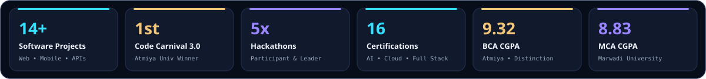
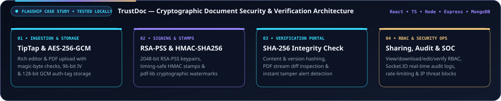
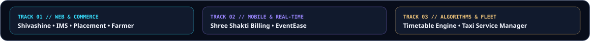
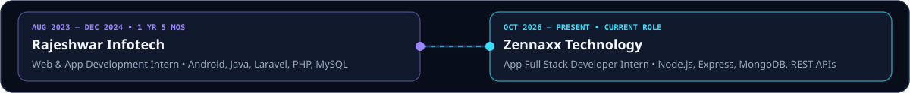
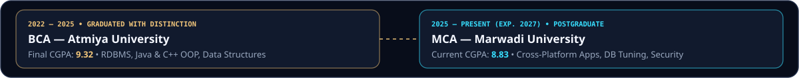
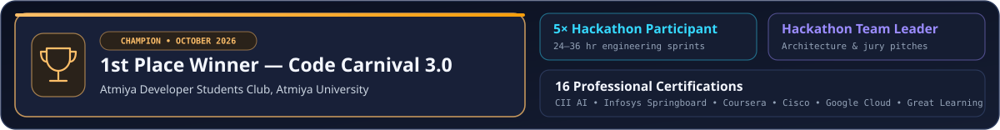

  <a href="https://hemang2601.github.io/portfolio/">
    <picture>
      <source media="(prefers-color-scheme: dark)" srcset="./assets/hero-dark.svg" />
      <source media="(prefers-color-scheme: light)" srcset="./assets/hero-light.svg" />
      
    </picture>
  </a>

    

  <h1>HEMANG LAKHADIYA</h1>
  

    <strong>Full Stack Developer &amp; Mobile Architect</strong> · App Full Stack Developer Intern @ <strong>Zennaxx Technology</strong> 
    Rajkot, Gujarat, India
  

  <picture>
    <source media="(prefers-color-scheme: dark)" srcset="https://readme-typing-svg.demolab.com?font=JetBrains+Mono&weight=600&size=20&duration=2800&pause=900&color=37DFFF&center=true&vCenter=true&width=760&height=42&lines=Full+Stack+Developer+%26+Mobile+Architect;App+Full+Stack+Developer+Intern+%40+Zennaxx+Technology;1st+Place+Winner+%E2%80%94+Code+Carnival+3.0;Backend+Systems+%E2%80%A2+APIs+%E2%80%A2+Cryptographic+Security" />
    <source media="(prefers-color-scheme: light)" srcset="https://readme-typing-svg.demolab.com?font=JetBrains+Mono&weight=600&size=20&duration=2800&pause=900&color=0284C7&center=true&vCenter=true&width=760&height=42&lines=Full+Stack+Developer+%26+Mobile+Architect;App+Full+Stack+Developer+Intern+%40+Zennaxx+Technology;1st+Place+Winner+%E2%80%94+Code+Carnival+3.0;Backend+Systems+%E2%80%A2+APIs+%E2%80%A2+Cryptographic+Security" />
    
  </picture>

  

    I build modern web applications, scalable backend systems, cross-platform mobile apps, and practical software products.
    My engineering work emphasizes backend architecture, relational and NoSQL database design, REST API development, cryptographic security, and end-to-end delivery.
  

  

    
    
    
    
  

## Professional Impact Dashboard

  <picture>
    <source media="(prefers-color-scheme: dark)" srcset="./assets/kpi-dashboard-dark.svg" />
    <source media="(prefers-color-scheme: light)" srcset="./assets/kpi-dashboard-light.svg" />
    
  </picture>

  <strong>14+ Software Projects</strong> ·
  <strong>1st Place – Code Carnival 3.0</strong> ·
  <strong>5x Hackathon Participation</strong> ·
  <strong>16 Professional Certifications</strong> ·
  <strong>BCA CGPA: 9.32</strong> ·
  <strong>MCA CGPA: 8.83</strong>

## Featured Project Showcase

### Flagship Project — TrustDoc (Secure Document Management &amp; Verification Platform)

  

 

<table>
  <tr>
    <td>
      
<strong>Category:</strong> Cryptographic Document Security &amp; Enterprise Verification Platform (Flagship MCA Project)

      
<strong>Description:</strong> Full-stack security platform engineered for tamper-evident document creation, encrypted storage, cryptographic integrity verification, and permissioned stakeholder sharing. Major modules have been implemented and verified in local testing.

      <ul>
        <li><strong>Document Creation, Upload &amp; PDF Engine:</strong> In-browser rich-text editor powered by TipTap with instant PDF export, cryptographic watermarking (<code>pdf-lib</code>), and secure file upload validation (magic-byte, MIME, and sanitization checks).</li>
        <li><strong>AES-256-GCM Encryption at Rest:</strong> Authenticated file encryption using per-operation 96-bit random IVs and 128-bit GCM authentication tags (<code>EncryptionService</code>), rejecting corrupted or tampered ciphertext.</li>
        <li><strong>RSA-PSS &amp; HMAC-SHA256 Digital Signatures:</strong> Cryptographic signing using 2048-bit RSA-PSS keypairs and timing-safe HMAC-SHA256 certification stamps (<code>SignatureService</code>) for author non-repudiation.</li>
        <li><strong>SHA-256 Integrity Verification &amp; Diffing:</strong> Content and version hashing with a public verification portal and PDF stream diff inspection to detect single-bit modifications.</li>
        <li><strong>RBAC, Permissioned Sharing &amp; Security Ops:</strong> Role-based access control (Admin, Organization Manager, User), granular share permissions (<code>view</code>, <code>download</code>, <code>edit</code>, <code>verify</code>) with expiration and revocation, real-time Socket.IO audit logs, rate-limiting, and IP threat blocking.</li>
      </ul>
      

        <strong>Architecture Stack:</strong> <code>React</code> <code>TypeScript</code> <code>Node.js</code> <code>Express</code> <code>MongoDB</code> <code>TipTap</code> <code>Tailwind CSS</code> <code>Socket.IO</code> <code>AES-256-GCM</code> <code>RSA-PSS</code> <code>SHA-256</code> 
        <strong>Status &amp; Reference:</strong> Major modules implemented and verified locally (Private Repository) · <a href="https://hemang2601.github.io/portfolio/#projects">View Portfolio Case Study →</a>
      

    </td>
  </tr>
</table>

 

### Core Portfolio &amp; Production Systems

  

 

<table>
  <tr>
    <td width="50%" valign="top">
      <h3>🛒 Shivashine Jewellery</h3>
      
<strong>Category:</strong> Web Application &amp; E-Commerce Platform

      
Production-ready online jewellery storefront built for multi-criteria catalog discovery, secure online payments, and live stock consistency.

      <ul>
        <li>Razorpay payment gateway integration for verified checkout flows</li>
        <li>Google OAuth user sign-in and session management</li>
        <li>Multi-attribute product catalog search and pricing filters</li>
        <li>Real-time inventory deduction preventing overselling on checkout</li>
      </ul>
      
<strong>Stack:</strong> <code>Laravel</code> <code>PHP</code> <code>Tailwind CSS</code> <code>JavaScript</code> <code>Razorpay API</code> <code>Google OAuth</code> <code>MySQL</code>

      
<strong>Status:</strong> Private / Team Repository · <a href="https://hemang2601.github.io/portfolio/#projects">Portfolio Case Study →</a>

    </td>
    <td width="50%" valign="top">
      <h3>📊 Enterprise Inventory Management System</h3>
      
<strong>Category:</strong> Web Application &amp; ERP Analytics

      
Commercial stock tracking and billing system built with interactive dashboards to surface sales trends, stock turnover, and reorder thresholds.

      <ul>
        <li>Interactive Chart.js visualizations for daily, monthly, and annual sales</li>
        <li>Automated minimum-threshold alerts for low-stock depletion</li>
        <li>Multi-role access separation between storekeepers and managers</li>
        <li>Billing and tax engine generating printable invoice receipts</li>
      </ul>
      
<strong>Stack:</strong> <code>Laravel</code> <code>Bootstrap</code> <code>Chart.js</code> <code>PHP</code> <code>MySQL</code>

      
<strong>Status:</strong> Private Repository · <a href="https://hemang2601.github.io/portfolio/#projects">Portfolio Case Study →</a>

    </td>
  </tr>
  <tr>
    <td width="50%" valign="top">
      <h3>🗓️ Automated Class Timetable Generator</h3>
      
<strong>Category:</strong> Web Application &amp; Algorithmic Matrix Engine

      
Algorithmic scheduling engine that generates conflict-free multi-department academic timetables with heavy server-side optimizations.

      <ul>
        <li>Matrix conflict-resolution logic balancing faculty and room availability</li>
        <li>Multi-department constraint mapping across lecture and lab sessions</li>
        <li>Server-side performance tuning preventing request timeouts</li>
        <li>One-click timetable generation with manual override support</li>
      </ul>
      
<strong>Stack:</strong> <code>Laravel</code> <code>PHP</code> <code>Bootstrap</code> <code>Matrix Logic</code> <code>MySQL</code>

      
<strong>Status:</strong> Private Institutional Repository · <a href="https://hemang2601.github.io/portfolio/#projects">Portfolio Case Study →</a>

    </td>
    <td width="50%" valign="top">
      <h3>📱 Shree Shakti Billing App</h3>
      
<strong>Category:</strong> Cross-Platform Mobile Utility (Flutter)

      
Mobile billing and client ledger utility engineered for on-field electrical service contractors needing reliable offline access.

      <ul>
        <li>Cross-platform responsive mobile UI constructed in Flutter and Dart</li>
        <li>Synchronized customer ledger tracking outstanding client balances</li>
        <li>Instant digital PDF invoice generation for on-field billing</li>
        <li>Offline-first local SQLite storage with client and job-work lookup</li>
      </ul>
      
<strong>Stack:</strong> <code>Flutter</code> <code>Dart</code> <code>SQLite Offline Storage</code>

      
<strong>Status:</strong> Public Repository · <a href="https://github.com/Hemang2601/Bill">github.com/Hemang2601/Bill →</a> (<a href="https://github.com/Hemang2601/Bill-MERN">MERN Edition</a>)

    </td>
  </tr>
  <tr>
    <td width="50%" valign="top">
      <h3>🚕 Automated Taxi Service Manager</h3>
      
<strong>Category:</strong> Web Application &amp; Fleet Operations

      
Full-stack fleet operations dashboard designed to track vehicles, manage active bookings, and compute mileage-based fares cleanly.

      <ul>
        <li>Real-time administrative dispatch console for vehicles and bookings</li>
        <li>Conflict-detection logic preventing overlapping driver shift schedules</li>
        <li>Relational data models handling dynamic mileage-based fare rules</li>
        <li>Customer trip history logs with itemized fare receipts</li>
      </ul>
      
<strong>Stack:</strong> <code>Laravel</code> <code>PHP</code> <code>Bootstrap</code> <code>MySQL</code>

      
<strong>Status:</strong> Private Repository · <a href="https://hemang2601.github.io/portfolio/#projects">Portfolio Case Study →</a>

    </td>
    <td width="50%" valign="top">
      <h3>🎓 Certificate &amp; Placement Analytics</h3>
      
<strong>Category:</strong> Web Portal &amp; Automated PDF Generation

      
Centralized campus portal where students upload extracurricular credentials for administrative validation and recruiter placement filtering.

      <ul>
        <li>Categorized credential vault for Sports, Technical, and Cultural records</li>
        <li>Multi-attribute recruiter filtering for campus placement shortlists</li>
        <li>On-demand PDF certificate rendering powered by TCPDF</li>
        <li>Student authentication, upload validation, and admin verification desk</li>
      </ul>
      
<strong>Stack:</strong> <code>Core PHP</code> <code>TCPDF</code> <code>Bootstrap</code> <code>JavaScript</code> <code>MySQL</code>

      
<strong>Status:</strong> Public Repository · <a href="https://github.com/Hemang2601/HACKTHON2">github.com/Hemang2601/HACKTHON2 →</a>

    </td>
  </tr>
  <tr>
    <td width="50%" valign="top">
      <h3>🌾 Farmer Bidding &amp; Marketplace</h3>
      
<strong>Category:</strong> Web Marketplace &amp; Agricultural E-Commerce

      
Two-sided marketplace connecting farmers directly with wholesale produce buyers for transparent crop listing and open price discovery.

      <ul>
        <li>Open pricing bidding workflow empowering competitive buyer offers</li>
        <li>Real-time crop inventory listings with quantity, grade, and photos</li>
        <li>Direct farmer-to-buyer communication removing broker intermediaries</li>
        <li>Lightweight UI tailored for low-bandwidth rural mobile devices</li>
      </ul>
      
<strong>Stack:</strong> <code>PHP</code> <code>JavaScript</code> <code>HTML5</code> <code>CSS3</code> <code>MySQL</code>

      
<strong>Status:</strong> Public Repository · <a href="https://github.com/Hemang2601/Farmar">github.com/Hemang2601/Farmar →</a>

    </td>
    <td width="50%" valign="top">
      <h3>🎟️ EventEase — College Event Registration &amp; Check-In</h3>
      
<strong>Category:</strong> Full-Stack Web Platform (Team NexGen Coders)

      
Real-time college event registration and check-in platform built as Team Leader to eliminate duplicate entries and slow gate queues.

      <ul>
        <li>Organizer event creation with automated registration capacity limits</li>
        <li>Instant student registration generating unique check-in passes</li>
        <li>Type-safe React + TypeScript frontend integrated with Drizzle &amp; Supabase</li>
        <li>Real-time attendance tracking dashboard for event coordinators</li>
      </ul>
      
<strong>Stack:</strong> <code>TypeScript</code> <code>React</code> <code>Drizzle</code> <code>Supabase</code>

      
<strong>Status:</strong> Public Repository · <a href="https://github.com/Hemang2601/EventEase">github.com/Hemang2601/EventEase →</a>

    </td>
  </tr>
</table>

  <strong>Additional Verified Public Repositories:</strong>
  <a href="https://github.com/Hemang2601/ELECTION_PROJECT">ELECTION_PROJECT</a> (PL/SQL &amp; Database Triggers) ·
  <a href="https://github.com/Hemang2601/Cryptography_4091">Cryptography_4091</a> (Python AES/DES/RSA/SHA) ·
  <a href="https://github.com/Hemang2601/hackathon1">hackathon1</a> (PHP Certificate Portal) ·
  <a href="https://github.com/Hemang2601/portfolio">portfolio</a> (Personal Portfolio Website)

## Technical Expertise

| Category | Technology Icons | Core Technologies |
| :--- | :--- | :--- |
| **Frontend** | <picture><source media="(prefers-color-scheme: dark)" srcset="https://skillicons.dev/icons?i=html,css,js,react,tailwind,bootstrap&theme=dark" /><source media="(prefers-color-scheme: light)" srcset="https://skillicons.dev/icons?i=html,css,js,react,tailwind,bootstrap&theme=light" /></picture> | `HTML` · `CSS` · `JavaScript` · `React` · `Tailwind CSS` · `Bootstrap` · `Chart.js` |
| **Backend** | <picture><source media="(prefers-color-scheme: dark)" srcset="https://skillicons.dev/icons?i=nodejs,express,php,laravel&theme=dark" /><source media="(prefers-color-scheme: light)" srcset="https://skillicons.dev/icons?i=nodejs,express,php,laravel&theme=light" /></picture> | `Node.js` · `Express.js` · `PHP` · `Laravel` · `REST APIs` · `SMTP` |
| **Mobile** | <picture><source media="(prefers-color-scheme: dark)" srcset="https://skillicons.dev/icons?i=flutter,dart,androidstudio,java&theme=dark" /><source media="(prefers-color-scheme: light)" srcset="https://skillicons.dev/icons?i=flutter,dart,androidstudio,java&theme=light" /></picture> | `Flutter` · `Dart` · `Android` · `Java` |
| **Database** | <picture><source media="(prefers-color-scheme: dark)" srcset="https://skillicons.dev/icons?i=mongodb,mysql&theme=dark" /><source media="(prefers-color-scheme: light)" srcset="https://skillicons.dev/icons?i=mongodb,mysql&theme=light" /></picture> | `MongoDB` · `MySQL` · `SQL` |
| **Programming** | <picture><source media="(prefers-color-scheme: dark)" srcset="https://skillicons.dev/icons?i=py,c,cpp&theme=dark" /><source media="(prefers-color-scheme: light)" srcset="https://skillicons.dev/icons?i=py,c,cpp&theme=light" /></picture> | `Python` · `C` · `C++` (plus JavaScript, PHP, Java, Dart) |
| **Tools &amp; Platforms** | <picture><source media="(prefers-color-scheme: dark)" srcset="https://skillicons.dev/icons?i=git,github,vscode,postman,firebase,gcp&theme=dark" /><source media="(prefers-color-scheme: light)" srcset="https://skillicons.dev/icons?i=git,github,vscode,postman,firebase,gcp&theme=light" /></picture> | `Git` · `GitHub` · `VS Code` · `Postman` · `Firebase` · `Google Cloud` |

## Experience, Education &amp; Achievements

### Professional Experience

  

 

<table>
  <tr>
    <td width="50%" valign="top">
      <h4>Zennaxx Technology — Full Stack Developer Intern</h4>
      
October 2026 – Present · Rajkot, Gujarat, India

      <ul>
        <li>Developing full-stack application features, REST APIs, and MongoDB schema architecture using <code>Node.js</code> and <code>Express.js</code>.</li>
        <li>Collaborating on backend engineering workflows and practical software product delivery.</li>
      </ul>
    </td>
    <td width="50%" valign="top">
      <h4>Rajeshwar Infotech — Web &amp; App Development Intern</h4>
      
August 2023 – December 2024 · Rajkot, Gujarat, India

      <ul>
        <li>Built native <code>Android (Java)</code> applications and full-stack web projects in <code>Laravel</code> and <code>PHP</code>.</li>
        <li>Designed and managed relational <code>MySQL</code> databases ensuring data integrity and reliable query performance.</li>
      </ul>
    </td>
  </tr>
</table>

### Education

  

 

* **Master of Computer Applications (MCA)** — Marwadi University *(2025 – Present, Exp. 2027)* · **CGPA: 8.83**
* **Bachelor of Computer Applications (BCA)** — Atmiya University *(2022 – 2025)* · **CGPA: 9.32 (Distinction)**

### Achievements &amp; Certifications

  

 

* 🏆 **1st Rank – Code Carnival 3.0**, Atmiya Developer Students Club, Atmiya University *(October 2026)* — Architected, implemented, and pitched a complete working software product under competitive hackathon conditions.
* **5x Hackathon Participation &amp; Team Leadership** — Led development teams across five 24–36 hour hackathons, coordinating system architecture, sprint tasks, debugging, and technical jury presentations.
* **16 Professional Certifications** — Verified credentials across **CII Centre for AI** (*Applied ML &amp; AI*), **Infosys Springboard** (*Node.js/Express/MongoDB, Database Design, Normalization*), **Coursera** (*Mastering Laravel &amp; PHP*), **Cisco Networking Academy** (*Python Essentials*), **Google Cloud** (*Foundations &amp; 3 Skill Badges*), **Great Learning** (*Android, Python for Data Science, SQL*), and **Udemy** (*Prompt Engineering for Data Analysis*) — [View Showcase on Portfolio →](https://hemang2601.github.io/portfolio/#certifications).

## GitHub Analytics

  

    
  

  <table>
    <tr>
      <td width="52%" align="center">
        <picture>
          <source media="(prefers-color-scheme: dark)" srcset="https://github-readme-stats.vercel.app/api?username=Hemang2601&show_icons=true&hide_border=true&bg_color=080D1A&title_color=F4F7FF&icon_color=37DFFF&text_color=9AA9C0" />
          <source media="(prefers-color-scheme: light)" srcset="https://github-readme-stats.vercel.app/api?username=Hemang2601&show_icons=true&hide_border=true&bg_color=F4F7FF&title_color=080D1A&icon_color=0284C7&text_color=334155" />
          
        </picture>
      </td>
      <td width="48%" align="center">
        <picture>
          <source media="(prefers-color-scheme: dark)" srcset="https://github-readme-stats.vercel.app/api/top-langs/?username=Hemang2601&layout=compact&hide_border=true&bg_color=080D1A&title_color=F4F7FF&text_color=9AA9C0" />
          <source media="(prefers-color-scheme: light)" srcset="https://github-readme-stats.vercel.app/api/top-langs/?username=Hemang2601&layout=compact&hide_border=true&bg_color=F4F7FF&title_color=080D1A&text_color=334155" />
          
        </picture>
      </td>
    </tr>
    <tr>
      <td width="52%" align="center">
        <picture>
          <source media="(prefers-color-scheme: dark)" srcset="https://streak-stats.demolab.com/?user=Hemang2601&hide_border=true&background=080D1A&stroke=1F2C48&ring=37DFFF&fire=F3C77B&currStreakNum=F4F7FF&sideNums=F4F7FF&currStreakLabel=37DFFF&sideLabels=9AA9C0&dates=9A86FF" />
          <source media="(prefers-color-scheme: light)" srcset="https://streak-stats.demolab.com/?user=Hemang2601&hide_border=true&background=F4F7FF&stroke=CBD5E1&ring=0284C7&fire=B45309&currStreakNum=080D1A&sideNums=080D1A&currStreakLabel=0284C7&sideLabels=334155&dates=6D5DF6" />
          
        </picture>
      </td>
      <td width="48%" align="center">
        <picture>
          <source media="(prefers-color-scheme: dark)" srcset="https://github-profile-summary-cards.vercel.app/api/cards/profile-details?username=Hemang2601&theme=github_dark" />
          <source media="(prefers-color-scheme: light)" srcset="https://github-profile-summary-cards.vercel.app/api/cards/profile-details?username=Hemang2601&theme=default" />
          
        </picture>
      </td>
    </tr>
  </table>

   

  

  
Live repository insights &amp; contributions: <a href="https://github.com/Hemang2601?tab=repositories">github.com/Hemang2601?tab=repositories</a>

## Connect

| Portfolio | GitHub | LinkedIn | Email | Location |
| :---: | :---: | :---: | :---: | :---: |
| [hemang2601.github.io/portfolio](https://hemang2601.github.io/portfolio/) | [github.com/Hemang2601](https://github.com/Hemang2601) | [linkedin.com/in/hemang-lakhadiya](https://www.linkedin.com/in/hemang-lakhadiya/) | [lakhadiyahemang@gmail.com](mailto:lakhadiyahemang@gmail.com) | Rajkot, Gujarat, India |

 

