

  <a href="https://hemang2601.github.io/portfolio/">
    <picture>
      <source media="(prefers-color-scheme: dark)" srcset="./assets/banner-dark.svg" />
      <source media="(prefers-color-scheme: light)" srcset="./assets/banner-light.svg" />
      
    </picture>
  </a>

    

  <h1>Hemang Lakhadiya</h1>
  

    <strong>Full Stack Developer &amp; Mobile Architect</strong> · App Full Stack Intern @ <strong>Zennaxx Technology</strong> 
    Rajkot, Gujarat, India · MCA Candidate @ Marwadi University
  

  <picture>
    <source media="(prefers-color-scheme: dark)" srcset="https://readme-typing-svg.demolab.com?font=JetBrains+Mono&weight=600&size=20&duration=2600&pause=900&color=E5B2A3&center=true&vCenter=true&width=760&height=42&lines=Full+Stack+Developer+%26+Mobile+Architect;Backend+Engineering+%E2%80%A2+REST+APIs+%E2%80%A2+Security;1st+Place+Winner+%E2%80%94+Code+Carnival+3.0;App+Full+Stack+Intern+%40+Zennaxx+Technology" />
    <source media="(prefers-color-scheme: light)" srcset="https://readme-typing-svg.demolab.com?font=JetBrains+Mono&weight=600&size=20&duration=2600&pause=900&color=A65D68&center=true&vCenter=true&width=760&height=42&lines=Full+Stack+Developer+%26+Mobile+Architect;Backend+Engineering+%E2%80%A2+REST+APIs+%E2%80%A2+Security;1st+Place+Winner+%E2%80%94+Code+Carnival+3.0;App+Full+Stack+Intern+%40+Zennaxx+Technology" />
    
  </picture>

  

    I build modern web applications, scalable backend systems, mobile applications, and practical software products.
    My engineering focus spans backend architecture, REST API development, relational &amp; NoSQL database design,
    cryptographic software security, and end-to-end product delivery.
  

  

    
    
    
    
  

  

    
    
  

   

  <picture>
    <source media="(prefers-color-scheme: dark)" srcset="./assets/kpi-dark.svg" />
    <source media="(prefers-color-scheme: light)" srcset="./assets/kpi-light.svg" />
    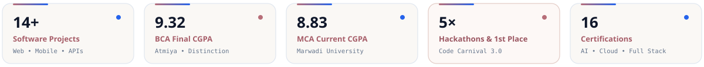
  </picture>

 

## GitHub Profile Statistics

  <table>
    <tr>
      <td align="center" width="52%">
        <picture>
          <source media="(prefers-color-scheme: dark)" srcset="https://github-readme-stats.vercel.app/api?username=Hemang2601&show_icons=true&hide_border=true&bg_color=161B22&title_color=F8FAFC&icon_color=E5B2A3&text_color=94A3B8&ring_color=E5B2A3" />
          <source media="(prefers-color-scheme: light)" srcset="https://github-readme-stats.vercel.app/api?username=Hemang2601&show_icons=true&hide_border=true&bg_color=FAF8F5&title_color=0F172A&icon_color=A65D68&text_color=475569&ring_color=A65D68" />
          
        </picture>
      </td>
      <td align="center" width="48%">
        <picture>
          <source media="(prefers-color-scheme: dark)" srcset="https://github-readme-stats.vercel.app/api/top-langs/?username=Hemang2601&layout=compact&hide_border=true&bg_color=161B22&title_color=F8FAFC&text_color=94A3B8" />
          <source media="(prefers-color-scheme: light)" srcset="https://github-readme-stats.vercel.app/api/top-langs/?username=Hemang2601&layout=compact&hide_border=true&bg_color=FAF8F5&title_color=0F172A&text_color=475569" />
          
        </picture>
      </td>
    </tr>
    <tr>
      <td align="center" width="52%">
        <picture>
          <source media="(prefers-color-scheme: dark)" srcset="https://streak-stats.demolab.com/?user=Hemang2601&hide_border=true&background=161B22&stroke=30363D&ring=E5B2A3&fire=E5B2A3&currStreakNum=F8FAFC&sideNums=F8FAFC&currStreakLabel=E5B2A3&sideLabels=94A3B8&dates=8B949E" />
          <source media="(prefers-color-scheme: light)" srcset="https://streak-stats.demolab.com/?user=Hemang2601&hide_border=true&background=FAF8F5&stroke=E2E8F0&ring=A65D68&fire=A65D68&currStreakNum=0F172A&sideNums=0F172A&currStreakLabel=A65D68&sideLabels=475569&dates=64748B" />
          
        </picture>
      </td>
      <td align="center" width="48%">
        <picture>
          <source media="(prefers-color-scheme: dark)" srcset="https://github-profile-summary-cards.vercel.app/api/cards/productive-time?username=Hemang2601&theme=github_dark&utcOffset=5.5" />
          <source media="(prefers-color-scheme: light)" srcset="https://github-profile-summary-cards.vercel.app/api/cards/productive-time?username=Hemang2601&theme=default&utcOffset=5.5" />
          
        </picture>
      </td>
    </tr>
  </table>

## Technical Skills &amp; Technology Stack

  <picture>
    <source media="(prefers-color-scheme: dark)" srcset="https://skillicons.dev/icons?i=html,css,js,react,tailwind,bootstrap,nodejs,express,php,laravel,flutter,dart,androidstudio,java,mongodb,mysql,python,c,cpp,git,github,vscode,postman,firebase,gcp&perline=13&theme=dark" />
    <source media="(prefers-color-scheme: light)" srcset="https://skillicons.dev/icons?i=html,css,js,react,tailwind,bootstrap,nodejs,express,php,laravel,flutter,dart,androidstudio,java,mongodb,mysql,python,c,cpp,git,github,vscode,postman,firebase,gcp&perline=13&theme=light" />
    
  </picture>

 

| Domain | Technologies &amp; Frameworks | Practical Focus |
| :--- | :--- | :--- |
| **Frontend** |        | Responsive UI engineering, interactive data dashboards, component layouts |
| **Backend** |       | Server-side MVC &amp; REST API architecture, auth pipelines, automated mailers |
| **Mobile** |     | Cross-platform Flutter apps, native Android builds, offline SQLite storage |
| **Database** |     | Relational normalization (1NF–BCNF), triggers, procedures, NoSQL modeling |
| **Programming** |       | Application logic, OOP design, data structures, cryptography scripting |
| **Tools** |       | Version control, API testing, cloud resource deployment, rapid prototyping |

## Featured Projects

### Flagship Ongoing MCA Project — TrustDoc

  <a href="https://hemang2601.github.io/portfolio/#projects">
    <picture>
      <source media="(prefers-color-scheme: dark)" srcset="./assets/trustdoc-dark.svg" />
      <source media="(prefers-color-scheme: light)" srcset="./assets/trustdoc-light.svg" />
      
    </picture>
  </a>

**TrustDoc – Secure Document Transfer &amp; Integrity Verification** *(MCA Semester 4 · Prototype in Progress · Private Repo)*
* **Stack:** `React` · `TypeScript` · `Node.js` · `Express.js` · `MongoDB` · `AES-256` · `RSA Signatures` · `SHA-256`
* **Key Security Capabilities:** Client-side AES-256 encryption, RSA author non-repudiation signatures, SHA-256 cryptographic tamper checks, granular RBAC permissions, and immutable document audit logging.

---

### Core Portfolio &amp; Production Systems

Interactive Glass UI Project Cards — click any card to open the public GitHub repository or portfolio case study.

  <table>
    <tr>
      <td width="50%" align="center">
        <a href="https://hemang2601.github.io/portfolio/#projects">
          <picture>
            <source media="(prefers-color-scheme: dark)" srcset="./assets/cards/proj-shivashine-dark.svg" />
            <source media="(prefers-color-scheme: light)" srcset="./assets/cards/proj-shivashine-light.svg" />
            
          </picture>
        </a>
      </td>
      <td width="50%" align="center">
        <a href="https://hemang2601.github.io/portfolio/#projects">
          <picture>
            <source media="(prefers-color-scheme: dark)" srcset="./assets/cards/proj-ims-dark.svg" />
            <source media="(prefers-color-scheme: light)" srcset="./assets/cards/proj-ims-light.svg" />
            
          </picture>
        </a>
      </td>
    </tr>
    <tr>
      <td width="50%" align="center">
        <a href="https://hemang2601.github.io/portfolio/#projects">
          <picture>
            <source media="(prefers-color-scheme: dark)" srcset="./assets/cards/proj-timetable-dark.svg" />
            <source media="(prefers-color-scheme: light)" srcset="./assets/cards/proj-timetable-light.svg" />
            
          </picture>
        </a>
      </td>
      <td width="50%" align="center">
        <a href="https://github.com/Hemang2601/Bill">
          <picture>
            <source media="(prefers-color-scheme: dark)" srcset="./assets/cards/proj-bill-dark.svg" />
            <source media="(prefers-color-scheme: light)" srcset="./assets/cards/proj-bill-light.svg" />
            
          </picture>
        </a>
      </td>
    </tr>
    <tr>
      <td width="50%" align="center">
        <a href="https://hemang2601.github.io/portfolio/#projects">
          <picture>
            <source media="(prefers-color-scheme: dark)" srcset="./assets/cards/proj-taxi-dark.svg" />
            <source media="(prefers-color-scheme: light)" srcset="./assets/cards/proj-taxi-light.svg" />
            
          </picture>
        </a>
      </td>
      <td width="50%" align="center">
        <a href="https://github.com/Hemang2601/HACKTHON2">
          <picture>
            <source media="(prefers-color-scheme: dark)" srcset="./assets/cards/proj-hackthon2-dark.svg" />
            <source media="(prefers-color-scheme: light)" srcset="./assets/cards/proj-hackthon2-light.svg" />
            
          </picture>
        </a>
      </td>
    </tr>
    <tr>
      <td width="50%" align="center">
        <a href="https://github.com/Hemang2601/Farmar">
          <picture>
            <source media="(prefers-color-scheme: dark)" srcset="./assets/cards/proj-farmar-dark.svg" />
            <source media="(prefers-color-scheme: light)" srcset="./assets/cards/proj-farmar-light.svg" />
            
          </picture>
        </a>
      </td>
      <td width="50%" align="center">
        <a href="https://github.com/Hemang2601/EventEase">
          <picture>
            <source media="(prefers-color-scheme: dark)" srcset="./assets/cards/proj-eventease-dark.svg" />
            <source media="(prefers-color-scheme: light)" srcset="./assets/cards/proj-eventease-light.svg" />
            
          </picture>
        </a>
      </td>
    </tr>
  </table>

#### Additional Verified Public Repositories

| Repository | Stack | Overview |
| :--- | :--- | :--- |
| **[Hemang2601/Bill-MERN](https://github.com/Hemang2601/Bill-MERN)** | `TypeScript` · `MERN Stack` | Full-stack business billing &amp; financial management platform for Shree Shakti Electric |
| **[Hemang2601/ELECTION_PROJECT](https://github.com/Hemang2601/ELECTION_PROJECT)** | `PL/SQL` · `MySQL Triggers` · `CLI` | Database-triggered real-time vote tallying engine eliminating middleware latency |
| **[Hemang2601/Cryptography_4091](https://github.com/Hemang2601/Cryptography_4091)** | `Python` | Practical implementations of AES, DES, 3DES, RSA, RC4, SHA-512, MD5 &amp; classical ciphers |
| **[Hemang2601/hackathon1](https://github.com/Hemang2601/hackathon1)** | `PHP` · `HTML5` · `CSS3` | Event management &amp; automated certificate customization portal |
| **[Hemang2601/portfolio](https://github.com/Hemang2601/portfolio)** | `HTML5` · `Tailwind CSS` · `GSAP` | Source repository for [hemang2601.github.io/portfolio](https://hemang2601.github.io/portfolio/) |

## Professional Experience

  <picture>
    <source media="(prefers-color-scheme: dark)" srcset="./assets/cards/experience-dark.svg" />
    <source media="(prefers-color-scheme: light)" srcset="./assets/cards/experience-light.svg" />
    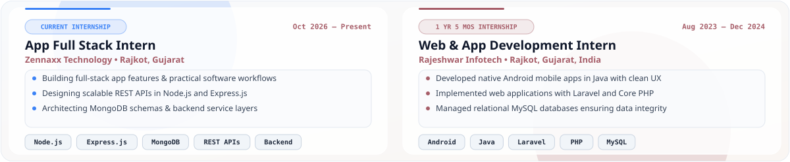
  </picture>

## Education

  <picture>
    <source media="(prefers-color-scheme: dark)" srcset="./assets/cards/education-dark.svg" />
    <source media="(prefers-color-scheme: light)" srcset="./assets/cards/education-light.svg" />
    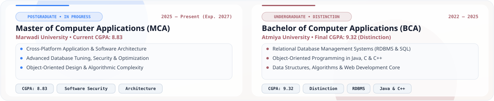
  </picture>

## Achievements &amp; Hackathons

  <picture>
    <source media="(prefers-color-scheme: dark)" srcset="./assets/cards/achievements-dark.svg" />
    <source media="(prefers-color-scheme: light)" srcset="./assets/cards/achievements-light.svg" />
    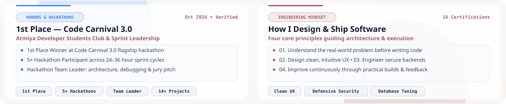
  </picture>

## Certifications

16 verified credentials across AI, Web Engineering, Cloud Architecture, Databases, and Programming ([View Full Showcase on Portfolio](https://hemang2601.github.io/portfolio/#certifications)):

| Issuer / Institution | Verified Credentials | Category |
| :--- | :--- | :--- |
| **CII Centre for AI** | *Foundational Course on Applied Machine Learning and AI* *(Featured · Sept 2026)* | Applied AI &amp; ML |
| **Infosys Springboard** | *Web Development with Node.js, Express &amp; MongoDB* · *Database Design* · *Normalization Concepts (1NF–BCNF)* | Full Stack &amp; DB |
| **Coursera** | *Mastering Laravel Framework &amp; PHP* | Backend Architecture |
| **Cisco Networking Academy** | *Python Essentials* | Programming |
| **Google Cloud** | *Cloud Computing Fundamentals* · *Infrastructure in Google Cloud* · *Networking in Google Cloud* · *3 Skill Badges (Cloud Resources, Network Security, Data/ML/AI Tasks)* | Cloud &amp; DevOps |
| **Great Learning** | *Android Application Development* · *Python for Data Science* · *SQL Query Mastery* | Mobile, Data &amp; SQL |
| **Udemy** | *Prompt Engineering for Data Analysis (Python, Pandas &amp; ChatGPT)* | AI &amp; Data Analysis |

## Current Focus / What I'm Building

* 🔐 **TrustDoc (MCA Semester 4 Flagship Project):** Engineering a secure document transfer and verification platform using React, TypeScript, Node.js, Express, and MongoDB with AES-256 encryption, RSA signatures, SHA-256 tamper checks, RBAC, and audit logging.
* ⚙️ **Backend Engineering @ Zennaxx Technology:** Developing scalable REST APIs, clean service layers, and MongoDB schemas with Node.js and Express.js.
* 📱 **Practical Cross-Platform &amp; Security Engineering:** Strengthening applied cryptography, relational/NoSQL database tuning, and offline-resilient Flutter architectures.

## GitHub Contribution Activity

  <picture>
    <source media="(prefers-color-scheme: dark)" srcset="https://github-profile-summary-cards.vercel.app/api/cards/profile-details?username=Hemang2601&theme=github_dark" />
    <source media="(prefers-color-scheme: light)" srcset="https://github-profile-summary-cards.vercel.app/api/cards/profile-details?username=Hemang2601&theme=default" />
    
  </picture>

    

  

## Contact / Let's Connect

  <a href="mailto:lakhadiyahemang@gmail.com">
    <picture>
      <source media="(prefers-color-scheme: dark)" srcset="./assets/cards/contact-dark.svg" />
      <source media="(prefers-color-scheme: light)" srcset="./assets/cards/contact-light.svg" />
      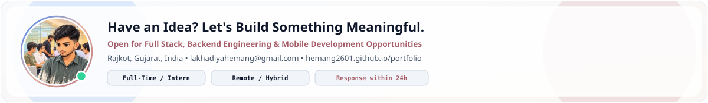
    </picture>
  </a>

    

| Channel | Direct Access |
| :--- | :--- |
| **Portfolio Website** | [https://hemang2601.github.io/portfolio/](https://hemang2601.github.io/portfolio/) |
| **Direct Email** | [lakhadiyahemang@gmail.com](mailto:lakhadiyahemang@gmail.com) |
| **LinkedIn** | [https://www.linkedin.com/in/hemang-lakhadiya/](https://www.linkedin.com/in/hemang-lakhadiya/) |
| **GitHub** | [https://github.com/Hemang2601](https://github.com/Hemang2601) |
| **Location** | Rajkot, Gujarat, India |

 

  <a href="https://hemang2601.github.io/portfolio/">
    <picture>
      <source media="(prefers-color-scheme: dark)" srcset="./assets/footer-dark.svg" />
      <source media="(prefers-color-scheme: light)" srcset="./assets/footer-light.svg" />
      
    </picture>
  </a>

