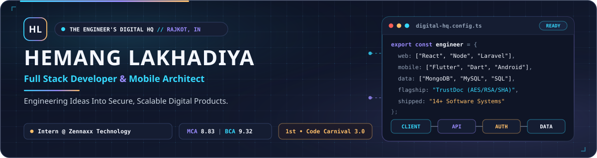
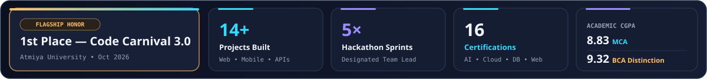

  <a href="https://hemang2601.github.io/portfolio/">
    <picture>
      <source media="(prefers-color-scheme: dark)" srcset="./assets/hero-dark.svg" />
      <source media="(prefers-color-scheme: light)" srcset="./assets/hero-light.svg" />
      
    </picture>
  </a>

    

  <h1>HEMANG LAKHADIYA</h1>
  

    <strong>Full Stack Developer &amp; Mobile Architect</strong> · App Full Stack Intern @ <strong>Zennaxx Technology</strong> 
    Rajkot, Gujarat, India · <em>"Engineering Ideas Into Secure, Scalable Digital Products."</em>
  

  

    I design and build web applications, backend APIs, cross-platform mobile apps, and database-driven software systems.
    My engineering focus centers on backend architecture, relational and NoSQL data modeling, cryptographic security, and shipping complete, reliable products.
  

  

    
    
    
    
  

## Engineering Identity Dashboard

  

  <strong>1st Place – Code Carnival 3.0</strong> (Atmiya University) ·
  <strong>14+ Projects</strong> ·
  <strong>5× Hackathon Participation</strong> (Team Leader) ·
  <strong>16 Certifications</strong> ·
  <strong>MCA CGPA: 8.83</strong> ·
  <strong>BCA CGPA: 9.32</strong>

## Featured Project Showcase

### Flagship Project — TrustDoc (Secure Document Transfer &amp; Integrity Verification)

  

 

<table>
  <tr>
    <td>
      
<strong>Overview:</strong> Flagship MCA software security system built for encrypted document sharing, cryptographic integrity verification, and verifiable access governance. Its major modules have been implemented and successfully tested locally.

      
<strong>Core Functionality:</strong> Client-side <strong>AES-256</strong> payload encryption, <strong>RSA digital signatures</strong> for author non-repudiation, <strong>SHA-256</strong> hash verification for tamper detection, granular <strong>RBAC</strong> access controls, and immutable audit logging.

      

        <strong>Stack:</strong> <code>React</code> <code>TypeScript</code> <code>Node.js</code> <code>Express.js</code> <code>MongoDB</code> <code>AES-256</code> <code>SHA-256</code> <code>RSA</code> <code>RBAC</code> 
        <strong>Status &amp; Link:</strong> Major modules implemented &amp; locally verified (Private Repo) · <a href="https://hemang2601.github.io/portfolio/#projects">View Portfolio Case Study →</a>
      

    </td>
  </tr>
</table>

 

### Production &amp; Portfolio Systems

<table>
  <tr>
    <td width="50%" valign="top">
      <h3>🛒 Shivashine Jewellery — E-Commerce Platform</h3>
      
Online jewellery storefront built for multi-attribute catalog discovery, secure checkout, and live stock consistency.

      <ul>
        <li><strong>Functionality:</strong> Razorpay payment integration, Google OAuth authentication, fast catalog filters, and real-time inventory deduction.</li>
        <li><strong>Stack:</strong> <code>Laravel</code> <code>PHP</code> <code>Tailwind CSS</code> <code>Razorpay</code> <code>MySQL</code></li>
        <li><strong>Status:</strong> Private / Team Repository · <a href="https://hemang2601.github.io/portfolio/#projects">Portfolio Case Study →</a></li>
      </ul>
    </td>
    <td width="50%" valign="top">
      <h3>📊 Enterprise Inventory Management System</h3>
      
Commercial stock tracking, billing, and sales analytics platform unifying store operations and forecasting.

      <ul>
        <li><strong>Functionality:</strong> Interactive Chart.js sales trends, automated low-stock alerts, multi-role access permissions, and printable tax invoices.</li>
        <li><strong>Stack:</strong> <code>Laravel</code> <code>Bootstrap</code> <code>Chart.js</code> <code>PHP</code> <code>MySQL</code></li>
        <li><strong>Status:</strong> Private Repository · <a href="https://hemang2601.github.io/portfolio/#projects">Portfolio Case Study →</a></li>
      </ul>
    </td>
  </tr>
  <tr>
    <td width="50%" valign="top">
      <h3>📱 Shree Shakti Billing App</h3>
      
Cross-platform mobile billing and customer ledger utility built for on-field electrical service contractors.

      <ul>
        <li><strong>Functionality:</strong> Instant digital PDF invoice generation, synchronized client balance ledgers, and offline-first local storage.</li>
        <li><strong>Stack:</strong> <code>Flutter</code> <code>Dart</code> <code>Offline Storage</code></li>
        <li><strong>Status:</strong> Public Repository · <a href="https://github.com/Hemang2601/Bill">github.com/Hemang2601/Bill →</a> (<a href="https://github.com/Hemang2601/Bill-MERN">MERN Edition</a>)</li>
      </ul>
    </td>
    <td width="50%" valign="top">
      <h3>🗓️ Automated Class Timetable Generator</h3>
      
Algorithmic matrix scheduling processor generating conflict-free departmental academic timetables in one click.

      <ul>
        <li><strong>Functionality:</strong> Matrix constraint resolution across faculty, classrooms, and lab batches with server-side execution tuning.</li>
        <li><strong>Stack:</strong> <code>Laravel</code> <code>PHP</code> <code>Bootstrap</code> <code>MySQL</code></li>
        <li><strong>Status:</strong> Private Institutional Repository · <a href="https://hemang2601.github.io/portfolio/#projects">Portfolio Case Study →</a></li>
      </ul>
    </td>
  </tr>
  <tr>
    <td width="50%" valign="top">
      <h3>🚕 Automated Taxi Service Manager</h3>
      
Full-stack fleet dispatch and trip management console coordinating vehicles, bookings, and driver shifts.

      <ul>
        <li><strong>Functionality:</strong> Real-time car dispatch desk, dynamic mileage-based fare calculation, and conflict-free driver shift scheduling.</li>
        <li><strong>Stack:</strong> <code>Laravel</code> <code>PHP</code> <code>Bootstrap</code> <code>MySQL</code></li>
        <li><strong>Status:</strong> Private Repository · <a href="https://hemang2601.github.io/portfolio/#projects">Portfolio Case Study →</a></li>
      </ul>
    </td>
    <td width="50%" valign="top">
      <h3>🎓 Certificate &amp; Placement Analytics</h3>
      
Academic extracurricular credential portal streamlining campus placement filtering and verified document exports.

      <ul>
        <li><strong>Functionality:</strong> Categorized credential uploads (Sports, Technical, Cultural), multi-attribute recruiter search, and on-demand TCPDF generation.</li>
        <li><strong>Stack:</strong> <code>PHP</code> <code>TCPDF</code> <code>Bootstrap</code> <code>JavaScript</code> <code>MySQL</code></li>
        <li><strong>Status:</strong> Public Repository · <a href="https://github.com/Hemang2601/HACKTHON2">github.com/Hemang2601/HACKTHON2 →</a></li>
      </ul>
    </td>
  </tr>
  <tr>
    <td width="50%" valign="top">
      <h3>🌾 Farmer Bidding &amp; Marketplace</h3>
      
Two-sided agricultural marketplace connecting farmers directly with wholesale produce buyers without intermediaries.

      <ul>
        <li><strong>Functionality:</strong> Crop inventory publishing with photo uploads, open pricing structural bids, and direct buyer communication.</li>
        <li><strong>Stack:</strong> <code>PHP</code> <code>JavaScript</code> <code>HTML5</code> <code>CSS3</code> <code>MySQL</code></li>
        <li><strong>Status:</strong> Public Repository · <a href="https://github.com/Hemang2601/Farmar">github.com/Hemang2601/Farmar →</a></li>
      </ul>
    </td>
    <td width="50%" valign="top">
      <h3>🎟️ EventEase — College Event Check-In</h3>
      
Real-time campus event registration and gate check-in platform built as Team Leader of NexGen Coders.

      <ul>
        <li><strong>Functionality:</strong> Capacity-aware event creation, student registration workflows, and unique pass verification for fast check-ins.</li>
        <li><strong>Stack:</strong> <code>TypeScript</code> <code>React</code> <code>Drizzle</code> <code>Supabase</code></li>
        <li><strong>Status:</strong> Public Repository · <a href="https://github.com/Hemang2601/EventEase">github.com/Hemang2601/EventEase →</a></li>
      </ul>
    </td>
  </tr>
</table>

  <strong>Additional Public Repositories:</strong>
  <a href="https://github.com/Hemang2601/ELECTION_PROJECT">ELECTION_PROJECT</a> (PL/SQL Triggers) ·
  <a href="https://github.com/Hemang2601/Cryptography_4091">Cryptography_4091</a> (Python AES/DES/RSA/SHA) ·
  <a href="https://github.com/Hemang2601/hackathon1">hackathon1</a> (PHP Certificate Portal) ·
  <a href="https://github.com/Hemang2601/portfolio">portfolio</a> (Personal Portfolio Source)

## Technology Matrix

| Layer | Icons | Stack |
| :--- | :--- | :--- |
| **Frontend** | <picture><source media="(prefers-color-scheme: dark)" srcset="https://skillicons.dev/icons?i=html,css,js,react,tailwind,bootstrap&theme=dark" /><source media="(prefers-color-scheme: light)" srcset="https://skillicons.dev/icons?i=html,css,js,react,tailwind,bootstrap&theme=light" /></picture> | `HTML5` · `CSS3` · `JavaScript` · `React` · `Tailwind CSS` · `Bootstrap` |
| **Backend** | <picture><source media="(prefers-color-scheme: dark)" srcset="https://skillicons.dev/icons?i=nodejs,express,php,laravel&theme=dark" /><source media="(prefers-color-scheme: light)" srcset="https://skillicons.dev/icons?i=nodejs,express,php,laravel&theme=light" /></picture> | `Node.js` · `Express.js` · `PHP` · `Laravel` · `REST APIs` |
| **Mobile** | <picture><source media="(prefers-color-scheme: dark)" srcset="https://skillicons.dev/icons?i=flutter,dart,java,androidstudio&theme=dark" /><source media="(prefers-color-scheme: light)" srcset="https://skillicons.dev/icons?i=flutter,dart,java,androidstudio&theme=light" /></picture> | `Flutter` · `Dart` · `Java` · `Android Development` |
| **Database** | <picture><source media="(prefers-color-scheme: dark)" srcset="https://skillicons.dev/icons?i=mongodb,mysql&theme=dark" /><source media="(prefers-color-scheme: light)" srcset="https://skillicons.dev/icons?i=mongodb,mysql&theme=light" /></picture> | `MongoDB` · `MySQL` · `SQL` |
| **Programming** | <picture><source media="(prefers-color-scheme: dark)" srcset="https://skillicons.dev/icons?i=js,py,php,java,c,cpp&theme=dark" /><source media="(prefers-color-scheme: light)" srcset="https://skillicons.dev/icons?i=js,py,php,java,c,cpp&theme=light" /></picture> | `JavaScript` · `Python` · `PHP` · `Java` · `C` · `C++` |
| **Tools** | <picture><source media="(prefers-color-scheme: dark)" srcset="https://skillicons.dev/icons?i=git,github,vscode,postman,firebase,gcp&theme=dark" /><source media="(prefers-color-scheme: light)" srcset="https://skillicons.dev/icons?i=git,github,vscode,postman,firebase,gcp&theme=light" /></picture> | `Git` · `GitHub` · `VS Code` · `Postman` · `Firebase` · `Google Cloud` |

## Professional Journey

<table>
  <tr>
    <td width="50%" valign="top">
      <h3>💼 Industry Experience</h3>
      

        <strong>App Full Stack Intern — Zennaxx Technology</strong> 
        October 2026 – Present · Rajkot, Gujarat
      

      <ul>
        <li>Developing full-stack application features, REST APIs, and MongoDB schemas with <code>Node.js</code> and <code>Express.js</code>.</li>
      </ul>
      

      

        <strong>Web &amp; App Development Intern — Rajeshwar Infotech</strong> 
        August 2023 – December 2024 · Rajkot, Gujarat
      

      <ul>
        <li>Built native <code>Android (Java)</code> applications and full-stack <code>Laravel</code> / <code>PHP</code> web projects backed by <code>MySQL</code>.</li>
      </ul>
    </td>
    <td width="50%" valign="top">
      <h3>🎓 Academic Timeline</h3>
      

        <strong>Master of Computer Applications (MCA)</strong> 
        Marwadi University · 2025 – Present (Exp. 2027) · <strong>CGPA: 8.83</strong>
      

      <ul>
        <li>Focus: Cross-platform architecture, database tuning, software security, and algorithmic complexity.</li>
      </ul>
      

      

        <strong>Bachelor of Computer Applications (BCA)</strong> 
        Atmiya University · 2022 – 2025 · <strong>CGPA: 9.32 (Distinction)</strong>
      

      <ul>
        <li>Focus: Relational database systems (RDBMS), OOP in Java &amp; C++, data structures, and web foundations.</li>
      </ul>
    </td>
  </tr>
</table>

## Achievement Spotlight

  

 

* 🏆 **1st Place Winner – Code Carnival 3.0**, Atmiya University *(Atmiya Developer Students Club · October 2026)* — Architected, built, and pitched a complete working software solution under competitive sprint deadlines.
* **5× Hackathon Participant** &amp; **Hackathon Team Leader** — Led system architecture, task delegation, integration debugging, and technical jury pitches across five 24–36 hour hackathons.
* **16 Professional Certifications** — Verified across **CII Centre for AI**, **Infosys Springboard**, **Coursera**, **Cisco Networking Academy**, **Google Cloud** (Foundations &amp; Skill Badges), **Great Learning**, and **Udemy** ([View Credentials on Portfolio](https://hemang2601.github.io/portfolio/#certifications)).

## HOW I ENGINEER

<table>
  <tr>
    <td width="50%" valign="top">
      <h4><code>01</code> — Build for Real Problems</h4>
      
I focus on practical software that solves actual business and user problems.

    </td>
    <td width="50%" valign="top">
      <h4><code>02</code> — Think Beyond the Interface</h4>
      
I care about backend architecture, data integrity, APIs and system reliability.

    </td>
  </tr>
  <tr>
    <td width="50%" valign="top">
      <h4><code>03</code> — Security by Design</h4>
      
I value authentication, authorization, encryption and secure document workflows.

    </td>
    <td width="50%" valign="top">
      <h4><code>04</code> — Ship Complete Products</h4>
      
I enjoy taking ideas from planning and architecture through implementation and testing.

    </td>
  </tr>
</table>

## GitHub Analytics

  <table>
    <tr>
      <td width="52%" align="center">
        <picture>
          <source media="(prefers-color-scheme: dark)" srcset="https://github-readme-stats.vercel.app/api?username=Hemang2601&show_icons=true&hide_border=true&bg_color=0B1020&title_color=F4F7FF&icon_color=35D9FF&text_color=94A3B8" />
          <source media="(prefers-color-scheme: light)" srcset="https://github-readme-stats.vercel.app/api?username=Hemang2601&show_icons=true&hide_border=true&bg_color=F4F7FF&title_color=0B1020&icon_color=0284C7&text_color=334155" />
          
        </picture>
      </td>
      <td width="48%" align="center">
        <picture>
          <source media="(prefers-color-scheme: dark)" srcset="https://github-readme-stats.vercel.app/api/top-langs/?username=Hemang2601&layout=compact&hide_border=true&bg_color=0B1020&title_color=F4F7FF&text_color=94A3B8" />
          <source media="(prefers-color-scheme: light)" srcset="https://github-readme-stats.vercel.app/api/top-langs/?username=Hemang2601&layout=compact&hide_border=true&bg_color=F4F7FF&title_color=0B1020&text_color=334155" />
          
        </picture>
      </td>
    </tr>
  </table>

  <picture>
    <source media="(prefers-color-scheme: dark)" srcset="https://streak-stats.demolab.com/?user=Hemang2601&hide_border=true&background=0B1020&stroke=232E4A&ring=35D9FF&fire=FFBF69&currStreakNum=F4F7FF&sideNums=F4F7FF&currStreakLabel=35D9FF&sideLabels=94A3B8&dates=9B8CFF" />
    <source media="(prefers-color-scheme: light)" srcset="https://streak-stats.demolab.com/?user=Hemang2601&hide_border=true&background=F4F7FF&stroke=CBD5E1&ring=0284C7&fire=D97706&currStreakNum=0B1020&sideNums=0B1020&currStreakLabel=0284C7&sideLabels=334155&dates=6D5DF6" />
    
  </picture>

    

  

## Connect

| Portfolio | GitHub | LinkedIn | Email | Location |
| :---: | :---: | :---: | :---: | :---: |
| [hemang2601.github.io/portfolio](https://hemang2601.github.io/portfolio/) | [github.com/Hemang2601](https://github.com/Hemang2601) | [linkedin.com/in/hemang-lakhadiya](https://www.linkedin.com/in/hemang-lakhadiya/) | [lakhadiyahemang@gmail.com](mailto:lakhadiyahemang@gmail.com) | Rajkot, Gujarat, India |

 

